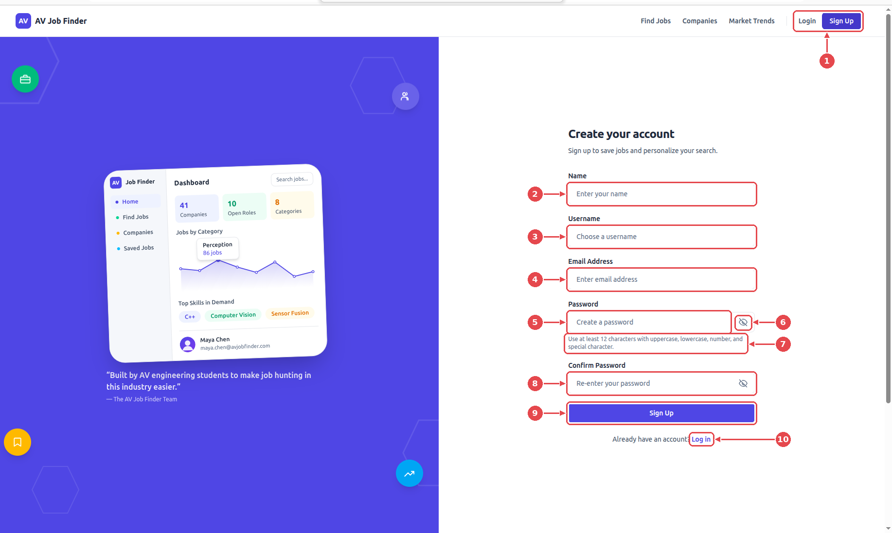
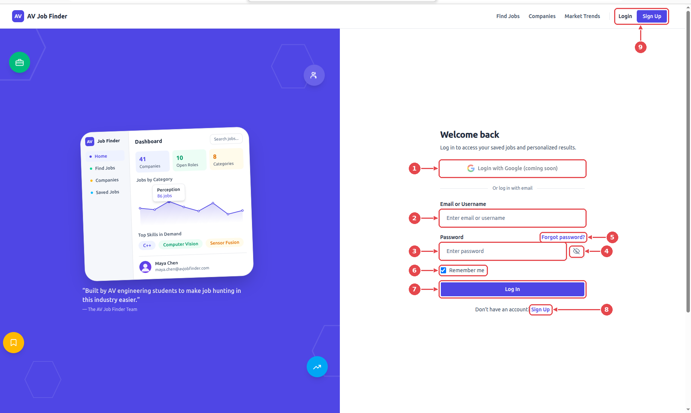
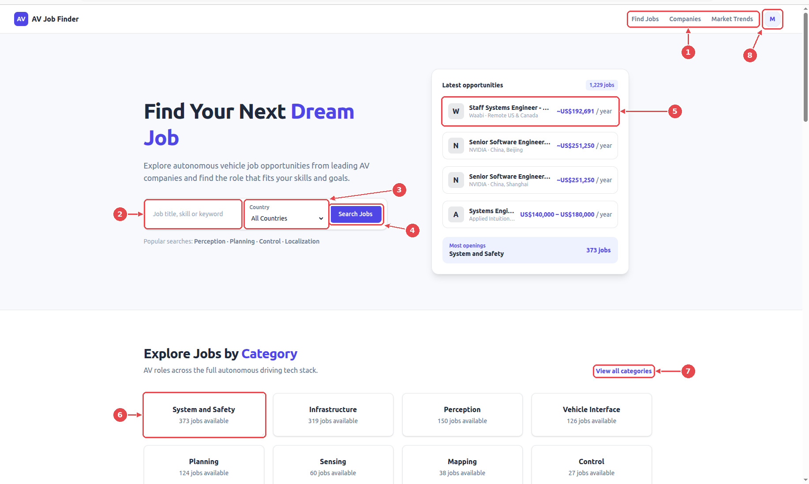
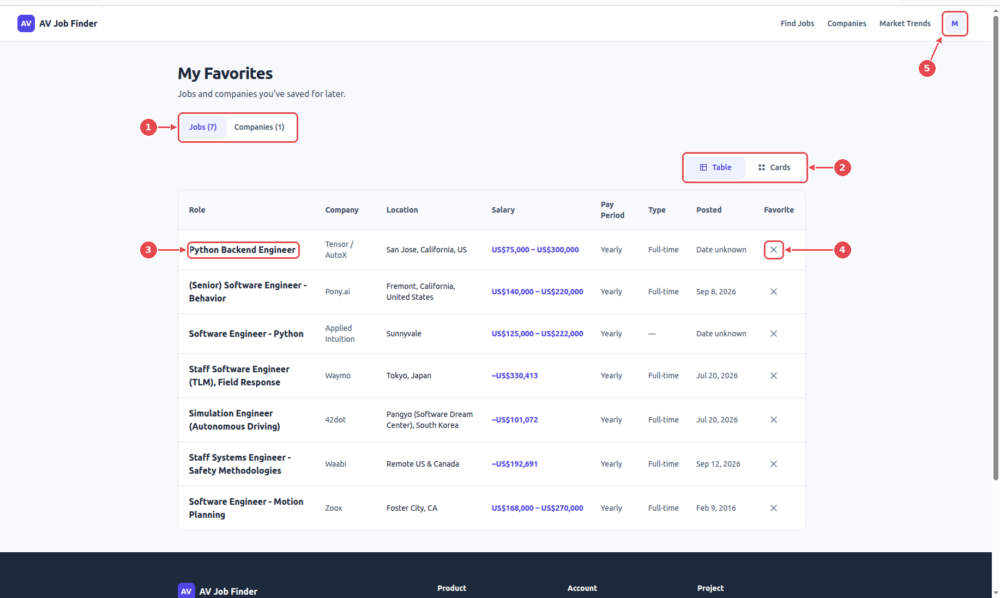

# User guide

A tour of the AV Job Finder pages. Each screenshot has numbered arrows; the list under it says what each one does. For installing and running the project, see the [README](../../README.md).

## Contents

- [Before you start](#before-you-start)
- [1. Sign up](#1-sign-up)
- [2. Log in](#2-log-in)
- [3. Home](#3-home)
- [4. Company profile](#4-company-profile)
- [5. Market Trends](#5-market-trends)
- [6. Find Jobs](#6-find-jobs)
- [7. My Account](#7-my-account)
- [8. My Favorites](#8-my-favorites)

## Before you start

You can browse jobs, companies and trends without an account. **Saving** jobs and companies, and the account pages, need you to sign in. Create an account on the **Sign Up** page (section 1) and use it on the **Log in** page (section 2), or use the [demo account](../../README.md#try-it-with-the-demo-account). Once you are signed in, the **Login** and **Sign Up** buttons are replaced by a round profile button.

## 1. Sign up

Create your account once. Open the page with the **Sign Up** button at the top right of any page.

1. **Login and Sign Up buttons.** At the top right of every page while you are signed out. They open the log-in page and this page.
2. **Name.** Your full name.
3. **Username.** 3 to 50 characters: letters, numbers, underscores, periods or hyphens. You can sign in with it later instead of your email.
4. **Email address.** A valid address. It must not already belong to another account.
5. **Password.** At least 12 characters, with an uppercase letter, a lowercase letter, a number and a special character.
6. **Eye icon.** Shows or hides what you typed in the password box, so you can check it. Press it again to hide it.
7. **Password rules.** The reminder shown under the box.
8. **Confirm password.** Type the same password again.
9. **Sign Up.** Creates the account. You are signed in straight away and taken to the home page. If the email or username is already taken, a message tells you.
10. **Log in.** Already have an account? This goes to the log-in page.

## 2. Log in

1. **Login with Google.** Not available yet ("coming soon"). Use your email or username instead.
2. **Email or Username.** Either one works.
3. **Password.** The one you chose when you signed up.
4. **Eye icon.** Shows or hides the password as you type.
5. **Forgot password?** Opens a **Password recovery** page. Recovery is not available yet: the page is a placeholder with a link back to log in.
6. **Remember me.** Ticked by default. It keeps you signed in for longer (a week by default, instead of 30 minutes).
7. **Log In.** Signs you in. After several wrong attempts in a row you have to wait a few minutes before trying again.
8. **Sign Up.** No account yet? This goes to the sign-up page.
9. **Login and Sign Up buttons.** The same buttons as on every other page while you are signed out.

## 3. Home

1. **Navigation bar.** Go to **Find Jobs**, **Companies** or **Market Trends**. It is at the top of every page, and the page you are on is highlighted.
2. **Keyword box.** Type a job title, skill or keyword, for example "perception" or "ROS".
3. **Country.** Optional. Limit the search to one country. The list only contains countries that currently have jobs.
4. **Search Jobs.** Opens **Find Jobs** with your keyword and country already filled in.
5. **Latest opportunities.** The newest postings with their pay. Click one to open its details.
6. **Category cards.** Each card is a job category and the number of jobs in it. Click a card to see only those jobs in **Find Jobs**.
7. **View all categories.** Opens **Find Jobs** with no category chosen, so you can pick one there.
8. **Profile button** (signed in). Opens a menu with **Change Information** (your account page), **My Favorite List** and the option to log out.

## 4. Company profile

Open it by clicking a company on the **Companies** page.

1. **Back to companies.** Return to the full company list.
2. **View careers page.** Goes to the company's own careers site.
3. **Description.** What the company does.
4. **Open positions.** How many of this company's jobs are listed here.
5. **Job cards.** Each open position with its location, pay, type and posting date. Click one to open the job.

## 5. Market Trends

1. **Zoom.** Use **+** to enlarge the chart (up to 400%) and **−** to shrink it; once enlarged, scroll or drag inside the chart to see more months. The **↺** button returns to 100%.
2. **Chart.** One line per skill, showing how many job postings list that skill each month. Hover over a month to see every skill's count. With the keyboard, Tab to the chart and use the left and right arrow keys.
3. **Skills list.** Click a skill to highlight its line and fade the others. Each entry also shows the skill's type (language, tool, framework and so on).
4. **Show as table.** Opens the same numbers as a table, which is easier to read exactly and works with screen readers.

Each month uses the last scrape of that month, and the counts are job postings that list the skill.

## 6. Find Jobs

1. **Search bar.** Type a job title, skill or keyword. The results update as you type.
2. **Category.** Show only one job category, such as Perception or Planning.
3. **Country.** Show only jobs located in one country.
4. **Seniority.** Show only one level, from Junior up. The level is read from the job title, so **Mid-level or not stated** also contains jobs whose title says nothing about level.
5. **Salary.** Type a minimum and/or a maximum, in US dollars per year. Each job's pay is converted to a yearly US dollar figure before it is compared.
6. **Apply** and **Clear.** The category, country, seniority and salary choices only take effect when you press **Apply**. **Clear** resets those four. To reset everything including the keyword, use the **Clear filters** link under the result count.
7. **Table** and **Cards.** Switch between a table and a card layout.
8. **Column headings.** Click **Role**, **Company** or **Posted** to sort by it; click again to reverse the order.
9. **Heart.** Saves the job to your favorites. If you are not signed in, you are taken to the login page.
10. **Per page** and **Prev / Next.** Choose how many jobs to show per page and move between pages.

Click a job title to open the full posting, including a **View original posting** link to the employer's ad. The address in your browser updates with your filters, so you can copy it to share a search.

## 7. My Account

Open it from the profile button, **Change Information**. You need to be signed in. The screenshot shows placeholder values instead of real personal details.

1. **Edit information.** Change your name, username, email, phone or address, then press **Save changes** (or **Cancel**). Changing your email also asks for your current password.
2. **Your details.** The information stored for your account, and the date you joined.
3. **Eye icon.** Shows or hides what you have typed in a password box, so you can check it. Press it again to hide it.
4. **Password rules.** A new password needs at least 12 characters, with an uppercase letter, a lowercase letter, a number and a special character.
5. **Update password.** Enter your current password, the new one, and the new one again, then press this button. You stay signed in. After several wrong current-password attempts you have to wait a few minutes before trying again.

## 8. My Favorites

Open it from the profile button, **My Favorite List**. You need to be signed in.

1. **Jobs** and **Companies** tabs. Switch between the jobs you saved (with the heart in **Find Jobs**) and the companies you saved on the **Companies** page. The number is how many you have.
2. **Table** and **Cards.** Switch the layout, as in **Find Jobs**.
3. **Job title.** Click it to open the job.
4. **✕ button.** Removes the job from your favorites.
5. **Profile button.** Open it and choose **My Favorite List** to reach this page from anywhere.
